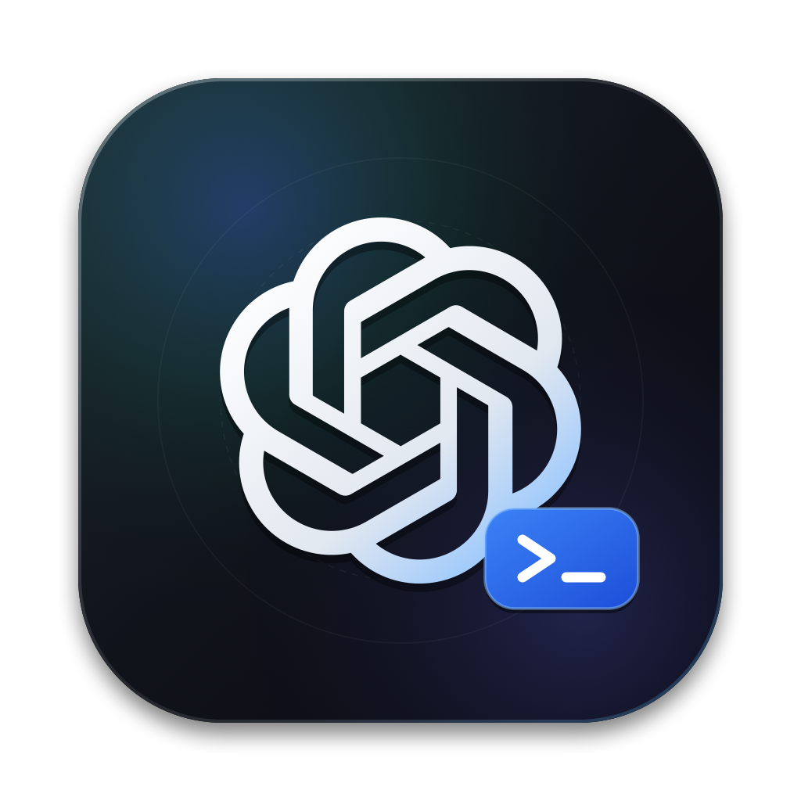

<p align="center">
  
</p>

<h1 align="center">Mini Codex (<code>mcodex</code>)</h1>

<p align="center">
  A Rust implementation of the Codex CLI &amp; Native macOS Desktop App (<code>tao</code> + <code>wry</code> + <code>ratatui</code>).
</p>

更新日期：2026-10-21。

## 桌面工作区

- **Chat、Work、Codex** 共用 macOS 原生窗口和进程内 Rust JSON-RPC 后端。各模式保存独立会话列表和草稿。Chat 不暴露本地执行工具。
- **会话** 支持搜索、置顶、重命名、项目、标签、分支、归档/恢复和删除。官方 Codex 会话可只读导入；继续工作时创建本地副本。删除本地会话会清除其 Goal，并暂停指向它的 heartbeat，保留调度定义及运行历史。
- **Work Pages** 提供本地富文本与旁栏 canvas、子页面/移动/页面树、Prompt/Task/Agent Instructions/Highlight、Pages/Chats 引用和隔离交互式可视化，以及块/列表/表格、附件和公式、查找替换、本地评论及修订。自动保存使用版本 CAS；原 Markdown 保留。选区 AI、新稿和可视化经真实 Responses 生成建议，由用户审阅后应用；页面内图片生成也需显式点击插入。支持 Markdown/JSON/Word 导出，以及系统打印存为 PDF。Word 保留格式、列表、表格和图片；公式以 LaTeX 文本导出。无云协作，未调用真实付费 API 验证。详见 [文档合同](docs/DOCUMENTS.md)。
- **Codex** 提供工作目录文件、Git 状态/diff、分支、可归档/恢复的 managed worktree、沙箱 shell、推理摘要、工具批准、MCP 工具和插件。
- **Codex 界面对齐（进行中）** 增加窗口导航历史、项目/执行位置栏、合并模型菜单、连接分组与独立置顶排序、手动排序、真实目录项目和已读状态。新工作树可显式携带本地改动；归档运行中或有关联跟进的聊天会先呈现具体操作。完整零差异验收仍未完成，见 [对齐记录](docs/PARITY.md)。
- **本地环境** 支持项目与继承配置、版本冲突保护、平台脚本、顶部操作、新工作树设置、输出、停止和失败重试。设置导出的变量用于后续命令；清理成功后才归档，恢复使用清理前的文件快照。普通聊天分支不自动选择或执行环境。新工作树还复制 `.worktreeinclude` 选中的忽略文件及被忽略的 `AGENTS.override.md`，保留目标已有文件。交互终端已接 PTY、ANSI、中文输入、缩放、Ctrl+C、多标签与重载恢复。同状态参照的完整视觉验收仍待补齐。
- **聊天分支** 支持当前工作区或同一工作树中的副本，以及携带当前文件状态的新 detached worktree。保留历史、项目、搜索偏好和来源关系；原聊天的 Goal、跟进和草稿保留在原处。“在此工作树中新建聊天”使用相同文件和分支，不复制旧历史。主流程已做浏览器、原生和真实 JSONL 验证；它不等同于 handoff。
- **聊天移交** 支持将更改和聊天移至工作树、带回主检出，或在已有工作树继续。成功归档保留原 Goal，删除关联 heartbeat 定义并保留运行历史；目标聊天不继承执行器。移交时中断运行中的 Goal 会先暂停它。Git 成功但聊天复制失败时保留 Git 与原聊天并显示警告。完整多窗口与退出恢复仍待验收。
- **Scheduled** 使用真实本地触发器。支持 RRULE、IANA 时区和 DST、cron 独立会话、heartbeat 原会话、多项目运行、调度专用 Git worktree、Run now、暂停/恢复、取消、通知策略和历史审阅状态。计划耗尽与执行成功分开记录。机器需要开机，App 或 app-server 需要保持运行。
- **Goals** 绑定会话并自动续跑。支持真实 provider token usage、可选预算、人工消息优先队列、暂停/恢复、编辑/替换/清除、usage/budget 限制，以及连续三次相同阻塞的停止判定。完成需要证据且无剩余工作；无工作工具调用会抑制自动续跑。内部继续指令参与模型上下文，但不显示为用户消息。
- **自动审批** “帮我批准”已接独立模型调用、只读检查、单次放行、拒绝和中断，以及历史恢复。普通命令使用原沙箱；额外访问需显式申请，失败不会自动提权重试。“允许类似命令”保存原请求的参数前缀，使用 Codex Starlark 规则引擎；单次批准不保存规则，文件会话授权只覆盖选定路径。审查使用官方默认策略，按模型目录选择 reviewer 和受支持的推理强度；自定义 provider 保留聊天模型回退，审查消耗实际 token。专用拒绝恢复接口只记录该具体动作的 developer 授权，不直接执行或开启新轮次；继承到分支的授权不作为新的直接授权。当前受管沙箱仅支持 macOS，完整原生交互与企业自定义策略仍待验收。见 [验收记录](design-qa.md)。
- **模型** 使用 API key 或 ChatGPT OAuth 调用 Responses API。模型菜单直接按本机 Codex App 的目录、顺序、每模型强度（含 Ultra）及 Standard/Fast 对齐。模型相关默认值可只读继承 Codex；本地覆盖单独保存。自定义 provider 的未知能力仍明确标注。详见 [模型目录](docs/MODELS.md)。
- **网页搜索** 已接入 Responses hosted search，支持自动、缓存、实时、主动搜索和禁用。搜索活动、可点击引用、完整来源、偏好和停止后的部分输出可恢复。全局开关不改变本地工具的网络权限。详见 [搜索合同](docs/SEARCH.md)。
- **文件与图片** 提供持久文件库、原件下载、PDF/Office/文本解析，以及 PNG/JPEG/WebP 输入。Images API 支持生成、编辑、mask、任务历史、取消等待及手动重试。需要有 Images 权限的 API key。详见 [图片合同](docs/IMAGES.md)。
- **语音** 提供 WebRTC 双向语音、转写、听写和结束清理。当前使用独立的 API key 通路，真实设备与 provider 仍待验收。
- **CLI 与远程 agent** 保留 `ratatui`、无界面执行和 JSONL app-server。`--no-default-features` 可构建不含 GUI 依赖的 Rust agent；[打包与安装](docs/HEADLESS_AGENT.md)提供真实目标归档、源码和 SHA256 manifest。
- **SSH 环境** 提供主机配置、指纹核对、连接状态、原输入区远程执行、批准回传和重连恢复。远端使用自己的账户与状态。连接关闭会停止 agent。详见 [SSH 使用范围](docs/REMOTE.md)。

- **Mini 与系统入口** 提供独立浮动窗口、Popout、置顶、全局 Mini/听写/截图快捷键和原生文件选择。窗口间草稿与附件需要接收方确认保存后才转移。关闭保存并隐藏，退出保存全部窗口并停止本地运行器。系统打印可保存干净的文档 PDF。

本轮指定的 Mini、全局入口、Work 本地内容类型与原生核心流程已完成，验收见 [NATIVE_LOCAL.md](docs/NATIVE_LOCAL.md)。云同步、分享、多人协作和云执行已由用户排除。项目为独立实现，完整官方生态、在线服务权限、真实语音设备和像素级一致不在本轮完成声明中；其他产品差异见 [PARITY.md](docs/PARITY.md)。

产品参考：[Pages](https://learn.chatgpt.com/docs/space/pages)、[Scheduled tasks](https://learn.chatgpt.com/docs/automations?surface=app)、[Long-running work](https://learn.chatgpt.com/docs/long-running-work)。当前实现截图：[Scheduled](docs/screenshots/07-scheduled.png)、[Goal 编辑器](docs/screenshots/08-goal-editor.png)。这些截图不代表像素级一致。

## 构建与运行

```bash
cargo run                 # 终端界面
cargo run -- app          # macOS 原生桌面窗口
cargo run -- preview      # 同一界面和 Rust 后端：http://127.0.0.1:5173
mcodex login              # 浏览器 OAuth；也可设置 OPENAI_API_KEY
./scripts/package-macos.sh
./scripts/package-macos.sh --debug --app-only # Fast local app bundle
./scripts/package-agent.sh --debug --offline # Actual host target, headless binary + source
```

macOS App 的 HTTP 客户端会读取系统代理设置。代理在系统设置中维护，App 不硬编码代理端口；TLS 证书校验继续开启。

浏览器 preview 是本地开发入口。它仅绑定 loopback，检查请求来源，并使用与原生窗口相同的本地工具。

隔离开发时，可禁用官方 Codex 会话和凭据导入：

```bash
MCODEX_HOME=/tmp/mini-codex-dev MCODEX_NO_CODEX_IMPORT=1 cargo run -- preview
```

应用将设置、项目、文档、会话、Goals 和调度记录写入 `MCODEX_HOME`，默认为 `~/.mcodex`。应用不修改官方 Codex 的 rollout 或设置文件。模型执行需要配置凭据。

## 验证

```bash
cargo test
cargo build
node --check src/gui_desktop.js
node --check src/gui_scheduled.js
node scripts/test-desktop-state.mjs
node scripts/test-rendering.mjs
node scripts/test-markdown.mjs
node scripts/test-connection-workspaces.mjs
node scripts/test-files-ui.mjs
node scripts/test-voice-ui.mjs
node scripts/test-scheduled-ui.mjs
node scripts/test-models-ui.mjs
node scripts/test-images-ui.mjs
node scripts/test-popovers.mjs
node scripts/test-remote-ui.mjs
node scripts/test-search-ui.mjs
node scripts/test-execution-context.mjs
node scripts/test-document-persistence.mjs
node scripts/test-embedded-ui.mjs
node scripts/test-native-windows.mjs
node scripts/test-codex-forks.mjs
node scripts/test-codex-handoff.mjs
node scripts/test-codex-permissions.mjs
node scripts/test-codex-environments.mjs
node scripts/test-codex-terminal.mjs
python3 scripts/smoke-desktop.py
python3 scripts/smoke-turns.py
python3 scripts/smoke-automations.py
python3 scripts/smoke-workspaces.py
python3 scripts/smoke-forks.py
python3 scripts/smoke-fork-states.py
python3 scripts/smoke-handoff.py
python3 scripts/smoke-handoff-failures.py
python3 scripts/smoke-guardian.py
python3 scripts/smoke-environments.py
python3 scripts/smoke-terminal.py
python3 scripts/smoke-account.py
python3 scripts/smoke-files.py
python3 scripts/smoke-voice.py
python3 scripts/smoke-models.py
python3 scripts/smoke-images.py
python3 scripts/smoke-remote.py
python3 scripts/smoke-documents.py
python3 scripts/smoke-document-ai.py
python3 scripts/smoke-search.py
```

已运行的测试、范围、RPC 数量与实屏记录统一维护在 [PARITY.md](docs/PARITY.md)。标记为 ignored 的辅助测试入口由对应的跨进程测试调用，不计入普通功能测试的通过数。

文档工具回归另需锁定的 JSDOM dev 依赖和 `EDITOR_TEST_NODE_MODULES`。临时安装、测试与清理命令见 [文档验证说明](docs/DOCUMENTS.md#验证与未完成范围)，不需要在仓库内保留 `node_modules`。

Smoke 脚本使用临时数据目录。模型相关脚本仅调用 loopback Responses mock，不访问外部模型或真实账户。它们验证真实 Rust 执行链，但不能代替真实账户、原生 WebKit、系统集成和完整桌面视觉验收。
